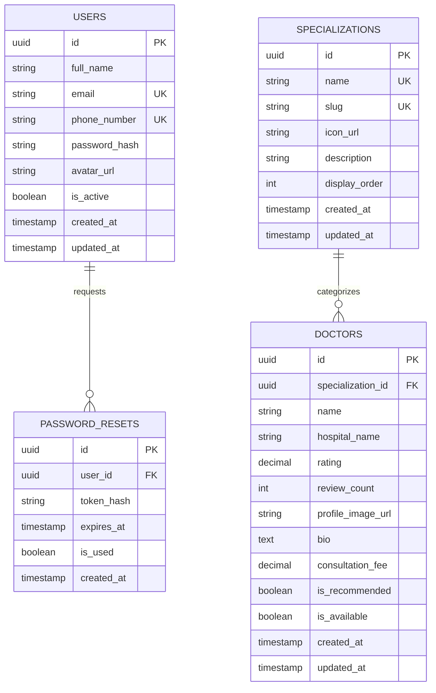

# Docdoc Telemedicine Backend Architecture & API Specification

Designed for **Docdoc Telemedicine Application** based on the mobile UI design.

---

## 1. Architecture & Stack Overview

- **Runtime & Language**: Node.js (v20+ LTS) with TypeScript
- **Framework**: Express.js
- **Database**: PostgreSQL 16 (Relational, ACID compliant, Trigram Full-Text search, strong indexing)
- **ORM / Query Builder**: Prisma ORM
- **Authentication**: JWT (JSON Web Tokens) with Argon2/Bcrypt password hashing
- **API Architecture**: RESTful API adhering to JSON envelope standard:
  ```json
  {
    "status": "success",
    "data": { ... },
    "meta": { ... }
  }
  ```

---

## 2. Entity Relationship Diagram (ERD)



---

## 3. Database Schema (PostgreSQL DDL)

```sql
-- Enable UUID extension
CREATE EXTENSION IF NOT EXISTS "uuid-ossp";
CREATE EXTENSION IF NOT EXISTS "pg_trgm"; -- For fuzzy doctor search

-- 1. USERS TABLE
CREATE TABLE users (
    id UUID PRIMARY KEY DEFAULT uuid_generate_v4(),
    full_name VARCHAR(150) NOT NULL,
    email VARCHAR(255) NOT NULL UNIQUE,
    phone_number VARCHAR(25) NOT NULL UNIQUE,
    password_hash VARCHAR(255) NOT NULL,
    avatar_url VARCHAR(500) DEFAULT NULL,
    is_active BOOLEAN DEFAULT TRUE NOT NULL,
    created_at TIMESTAMPTZ DEFAULT CURRENT_TIMESTAMP NOT NULL,
    updated_at TIMESTAMPTZ DEFAULT CURRENT_TIMESTAMP NOT NULL
);

CREATE INDEX idx_users_email ON users(email);
CREATE INDEX idx_users_phone_number ON users(phone_number);

-- 2. PASSWORD RESETS TABLE
CREATE TABLE password_resets (
    id UUID PRIMARY KEY DEFAULT uuid_generate_v4(),
    user_id UUID NOT NULL REFERENCES users(id) ON DELETE CASCADE,
    token_hash VARCHAR(255) NOT NULL,
    expires_at TIMESTAMPTZ NOT NULL,
    is_used BOOLEAN DEFAULT FALSE NOT NULL,
    created_at TIMESTAMPTZ DEFAULT CURRENT_TIMESTAMP NOT NULL
);

CREATE INDEX idx_password_resets_token_hash ON password_resets(token_hash);
CREATE INDEX idx_password_resets_user_id ON password_resets(user_id);

-- 3. SPECIALIZATIONS TABLE
CREATE TABLE specializations (
    id UUID PRIMARY KEY DEFAULT uuid_generate_v4(),
    name VARCHAR(100) NOT NULL UNIQUE,
    slug VARCHAR(100) NOT NULL UNIQUE,
    icon_url VARCHAR(500) NOT NULL,
    description TEXT,
    display_order INT DEFAULT 0 NOT NULL,
    created_at TIMESTAMPTZ DEFAULT CURRENT_TIMESTAMP NOT NULL,
    updated_at TIMESTAMPTZ DEFAULT CURRENT_TIMESTAMP NOT NULL
);

CREATE INDEX idx_specializations_slug ON specializations(slug);
CREATE INDEX idx_specializations_display_order ON specializations(display_order ASC);

-- 4. DOCTORS TABLE
CREATE TABLE doctors (
    id UUID PRIMARY KEY DEFAULT uuid_generate_v4(),
    specialization_id UUID NOT NULL REFERENCES specializations(id) ON DELETE RESTRICT,
    name VARCHAR(150) NOT NULL,
    hospital_name VARCHAR(200) NOT NULL,
    rating NUMERIC(2, 1) DEFAULT 0.0 NOT NULL CHECK (rating >= 0.0 AND rating <= 5.0),
    review_count INTEGER DEFAULT 0 NOT NULL CHECK (review_count >= 0),
    profile_image_url VARCHAR(500) NOT NULL,
    bio TEXT,
    consultation_fee NUMERIC(10, 2) DEFAULT 0.00,
    is_recommended BOOLEAN DEFAULT FALSE NOT NULL,
    is_available BOOLEAN DEFAULT TRUE NOT NULL,
    created_at TIMESTAMPTZ DEFAULT CURRENT_TIMESTAMP NOT NULL,
    updated_at TIMESTAMPTZ DEFAULT CURRENT_TIMESTAMP NOT NULL
);

CREATE INDEX idx_doctors_specialization_id ON doctors(specialization_id);
CREATE INDEX idx_doctors_rating_reviews ON doctors(rating DESC, review_count DESC);
CREATE INDEX idx_doctors_recommended ON doctors(is_recommended) WHERE is_recommended = TRUE;
-- Trigram index for fast text search on doctor name
CREATE INDEX idx_doctors_name_trgm ON doctors USING gin (name gin_trgm_ops);
```

---

## 4. Prisma ORM Schema (`prisma/schema.prisma`)

```prisma
datasource db {
  provider = "postgresql"
  url      = env("DATABASE_URL")
}

generator client {
  provider = "prisma-client-js"
}

model User {
  id             String          @id @default(uuid()) @db.Uuid
  fullName       String          @map("full_name") @db.VarChar(150)
  email          String          @unique @db.VarChar(255)
  phoneNumber    String          @unique @map("phone_number") @db.VarChar(25)
  passwordHash   String          @map("password_hash") @db.VarChar(255)
  avatarUrl      String?         @map("avatar_url") @db.VarChar(500)
  isActive       Boolean         @default(true) @map("is_active")
  createdAt      DateTime        @default(now()) @map("created_at") @db.Timestamptz()
  updatedAt      DateTime        @updatedAt @map("updated_at") @db.Timestamptz()
  passwordResets PasswordReset[]

  @@map("users")
}

model PasswordReset {
  id        String   @id @default(uuid()) @db.Uuid
  userId    String   @map("user_id") @db.Uuid
  tokenHash String   @map("token_hash") @db.VarChar(255)
  expiresAt DateTime @map("expires_at") @db.Timestamptz()
  isUsed    Boolean  @default(false) @map("is_used")
  createdAt DateTime @default(now()) @map("created_at") @db.Timestamptz()
  user      User     @relation(fields: [userId], references: [id], onDelete: Cascade)

  @@index([tokenHash])
  @@map("password_resets")
}

model Specialization {
  id           String   @id @default(uuid()) @db.Uuid
  name         String   @unique @db.VarChar(100)
  slug         String   @unique @db.VarChar(100)
  iconUrl      String   @map("icon_url") @db.VarChar(500)
  description  String?  @db.Text
  displayOrder Int      @default(0) @map("display_order")
  createdAt    DateTime @default(now()) @map("created_at") @db.Timestamptz()
  updatedAt    DateTime @updatedAt @map("updated_at") @db.Timestamptz()
  doctors      Doctor[]

  @@map("specializations")
}

model Doctor {
  id               String         @id @default(uuid()) @db.Uuid
  specializationId String         @map("specialization_id") @db.Uuid
  name             String         @db.VarChar(150)
  hospitalName     String         @map("hospital_name") @db.VarChar(200)
  rating           Decimal        @default(0.0) @db.Decimal(2, 1)
  reviewCount      Int            @default(0) @map("review_count")
  profileImageUrl  String         @map("profile_image_url") @db.VarChar(500)
  bio              String?        @db.Text
  consultationFee  Decimal?       @default(0.00) @map("consultation_fee") @db.Decimal(10, 2)
  isRecommended    Boolean        @default(false) @map("is_recommended")
  isAvailable      Boolean        @default(true) @map("is_available")
  createdAt        DateTime       @default(now()) @map("created_at") @db.Timestamptz()
  updatedAt        DateTime       @updatedAt @map("updated_at") @db.Timestamptz()
  specialization   Specialization @relation(fields: [specializationId], references: [id])

  @@index([specializationId])
  @@index([rating, reviewCount])
  @@map("doctors")
}
```

---

## 5. RESTful API Endpoints Specification

Base URL: `/api/v1`

Standard Response Envelope:
```json
{
  "status": "success", // "success" | "error"
  "message": "Human readable message (optional)",
  "data": { ... },
  "meta": { ... } // Pagination / metadata if applicable
}
```

Standard Error Envelope:
```json
{
  "status": "error",
  "code": "VALIDATION_ERROR | UNAUTHORIZED | NOT_FOUND | CONFLICT | INTERNAL_SERVER_ERROR",
  "message": "Brief error explanation",
  "errors": [
    {
      "field": "email",
      "message": "Email is already registered"
    }
  ]
}
```

---

### Module 1: Authentication

#### 1.1 Register New User
- **Endpoint**: `POST /api/v1/auth/register`
- **Description**: Registers a new patient account, hashes the password using Argon2/Bcrypt, creates the user record, and issues an initial JWT token.
- **Authentication**: None (Public)
- **Headers**: `Content-Type: application/json`

**Request Body**:
```json
{
  "name": "Alex Morgan",
  "email": "alex.morgan@example.com",
  "password": "SecurePassword123!",
  "password_confirmation": "SecurePassword123!",
  "phone": "+6281234567890"
}
```

**Validation Rules**:
- `name`: string, required, min 2 chars, max 150 chars.
- `email`: string, required, valid email format, normalized to lowercase, unique in `users`.
- `password`: string, required, min 8 characters, at least 1 uppercase, 1 lowercase, 1 number, 1 special character.
- `password_confirmation`: string, required, must match `password`.
- `phone`: string, required, valid E.164 phone format, unique in `users`.

**Responses**:
- **201 Created**:
```json
{
  "status": "success",
  "message": "Account created successfully",
  "data": {
    "user": {
      "id": "a5e8f496-6e4b-4b11-9238-16ef784e2a10",
      "full_name": "Alex Morgan",
      "email": "alex.morgan@example.com",
      "phone_number": "+6281234567890",
      "avatar_url": null,
      "created_at": "2026-11-08T13:30:00.000Z"
    },
    "token": {
      "access_token": "eyJhbGciOiJIUzI1NiIsInR5cCI6IkpXVCJ9...",
      "token_type": "Bearer",
      "expires_in": 86400
    }
  }
}
```
- **409 Conflict**:
```json
{
  "status": "error",
  "code": "RESOURCE_EXISTS",
  "message": "Email or phone number is already registered",
  "errors": [
    {
      "field": "email",
      "message": "Email alex.morgan@example.com is already registered"
    }
  ]
}
```
- **422 Unprocessable Entity**:
```json
{
  "status": "error",
  "code": "VALIDATION_ERROR",
  "message": "Validation failed",
  "errors": [
    {
      "field": "password_confirmation",
      "message": "Password confirmation does not match password"
    }
  ]
}
```

---

#### 1.2 User Login
- **Endpoint**: `POST /api/v1/auth/login`
- **Description**: Authenticates user credentials and returns a signed JWT token.
- **Authentication**: None (Public)
- **Headers**: `Content-Type: application/json`

**Request Body**:
```json
{
  "email": "alex.morgan@example.com",
  "password": "SecurePassword123!",
  "remember_me": true
}
```

**Responses**:
- **200 OK**:
```json
{
  "status": "success",
  "message": "Login successful",
  "data": {
    "user": {
      "id": "a5e8f496-6e4b-4b11-9238-16ef784e2a10",
      "full_name": "Alex Morgan",
      "email": "alex.morgan@example.com",
      "phone_number": "+6281234567890",
      "avatar_url": "https://cdn.docdoc.com/avatars/user-1.jpg"
    },
    "token": {
      "access_token": "eyJhbGciOiJIUzI1NiIsInR5cCI6IkpXVCJ9...",
      "token_type": "Bearer",
      "expires_in": 2592000
    }
  }
}
```
- **401 Unauthorized**:
```json
{
  "status": "error",
  "code": "INVALID_CREDENTIALS",
  "message": "Invalid email or password"
}
```

---

#### 1.3 Forgot Password
- **Endpoint**: `POST /api/v1/auth/forgot-password`
- **Description**: Initiates password recovery. If the account exists, creates a cryptographically secure reset token (stored hashed with a 15-minute expiration) and dispatches an email containing the reset link/OTP. Always returns a generic 200 response to prevent email enumeration attacks.
- **Authentication**: None (Public)
- **Headers**: `Content-Type: application/json`

**Request Body**:
```json
{
  "email": "alex.morgan@example.com"
}
```

**Responses**:
- **200 OK**:
```json
{
  "status": "success",
  "message": "If this email is registered in our system, a password reset link has been sent."
}
```
- **422 Unprocessable Entity**:
```json
{
  "status": "error",
  "code": "VALIDATION_ERROR",
  "message": "A valid email address is required"
}
```

---

### Module 2: Specializations

#### 2.1 Get All Specializations
- **Endpoint**: `GET /api/v1/specializations`
- **Description**: Returns all medical categories for the doctor speciality grid and homepage quick links. Supports optional `limit` for homepage preview.
- **Authentication**: Public or Authenticated (`Bearer <token>`)
- **Query Parameters**:
  - `limit` *(optional, integer)*: Maximum number of records to return (e.g. `limit=4` for the homepage).
  - `sort` *(optional, string)*: Sort order, e.g. `display_order:asc` (default) or `name:asc`.

**Responses**:
- **200 OK**:
```json
{
  "status": "success",
  "data": {
    "specializations": [
      {
        "id": "1d8cf01b-97c2-48df-9f33-c23f66c98aa1",
        "name": "General",
        "slug": "general",
        "icon_url": "https://cdn.docdoc.com/icons/specialities/general.svg",
        "doctor_count": 42
      },
      {
        "id": "2e7a33bc-11a8-43d9-951c-43f9a77bd202",
        "name": "Neurologic",
        "slug": "neurologic",
        "icon_url": "https://cdn.docdoc.com/icons/specialities/neurologic.svg",
        "doctor_count": 18
      },
      {
        "id": "3f8b44cd-22b9-44e0-962d-540ab88ce313",
        "name": "Pediatric",
        "slug": "pediatric",
        "icon_url": "https://cdn.docdoc.com/icons/specialities/pediatric.svg",
        "doctor_count": 27
      },
      {
        "id": "4a9c55de-33ca-45f1-973e-651bc99df424",
        "name": "Radiology",
        "slug": "radiology",
        "icon_url": "https://cdn.docdoc.com/icons/specialities/radiology.svg",
        "doctor_count": 14
      },
      {
        "id": "5b0d66ef-44db-4602-984f-762cd00ea535",
        "name": "ENT",
        "slug": "ent",
        "icon_url": "https://cdn.docdoc.com/icons/specialities/ent.svg",
        "doctor_count": 19
      },
      {
        "id": "6c1e77f0-55ec-4713-9950-873de11fb646",
        "name": "Dentistry",
        "slug": "dentistry",
        "icon_url": "https://cdn.docdoc.com/icons/specialities/dentistry.svg",
        "doctor_count": 31
      },
      {
        "id": "7d2f8801-66fd-4824-0061-984ef22ac757",
        "name": "Cardiologist",
        "slug": "cardiologist",
        "icon_url": "https://cdn.docdoc.com/icons/specialities/cardiologist.svg",
        "doctor_count": 22
      }
    ]
  },
  "meta": {
    "total": 12
  }
}
```

---

### Module 3: Doctors

#### 3.1 List Doctors (Search & Filter)
- **Endpoint**: `GET /api/v1/doctors`
- **Description**: Retrieves a paginated list of doctors, filterable by medical specialization and searchable by doctor name or hospital name.
- **Authentication**: Public or Authenticated
- **Query Parameters**:
  - `search` *(optional, string)*: Substring or fuzzy search on doctor name (e.g., `?search=Randy`).
  - `specialization_id` *(optional, UUID)*: Filter by specialization ID.
  - `page` *(optional, integer, default: 1)*: Page number.
  - `limit` *(optional, integer, default: 10, max: 50)*: Items per page.
  - `sort_by` *(optional, string, default: "rating")*: Sort field (`rating`, `review_count`, `name`, `created_at`).
  - `sort_order` *(optional, string, default: "desc")*: Sort order (`asc` or `desc`).

**Example Request**:
`GET /api/v1/doctors?search=Randy&page=1&limit=10`

**Responses**:
- **200 OK**:
```json
{
  "status": "success",
  "data": {
    "doctors": [
      {
        "id": "d019f2a4-54c7-43c2-849d-64971c26f041",
        "name": "Dr. Randy Wigham",
        "hospital_name": "RSUD Gatot Subroto",
        "rating": 4.8,
        "review_count": 4279,
        "profile_image_url": "https://cdn.docdoc.com/doctors/dr-randy-wigham.jpg",
        "is_available": true,
        "specialization": {
          "id": "1d8cf01b-97c2-48df-9f33-c23f66c98aa1",
          "name": "General",
          "slug": "general"
        }
      }
    ]
  },
  "meta": {
    "pagination": {
      "current_page": 1,
      "per_page": 10,
      "total_items": 1,
      "total_pages": 1,
      "has_next_page": false,
      "has_prev_page": false
    }
  }
}
```

---

#### 3.2 Get Recommended Doctors
- **Endpoint**: `GET /api/v1/doctors/recommended`
- **Description**: Returns top-rated, highly-reviewed doctors. Used on Homepage "Recommendation Doctor" section and Recommendation Doctor list screen.
- **Authentication**: Public or Authenticated
- **Query Parameters**:
  - `limit` *(optional, integer, default: 5)*: Number of doctors to return.

**Responses**:
- **200 OK**:
```json
{
  "status": "success",
  "data": {
    "recommended_doctors": [
      {
        "id": "d019f2a4-54c7-43c2-849d-64971c26f041",
        "name": "Dr. Randy Wigham",
        "hospital_name": "RSUD Gatot Subroto",
        "rating": 4.8,
        "review_count": 4279,
        "profile_image_url": "https://cdn.docdoc.com/doctors/dr-randy-wigham.jpg",
        "is_available": true,
        "specialization": {
          "id": "1d8cf01b-97c2-48df-9f33-c23f66c98aa1",
          "name": "General",
          "slug": "general"
        }
      },
      {
        "id": "e120f3b5-65d8-44d3-95ae-75082d370152",
        "name": "Dr. Jack Sullivan",
        "hospital_name": "RSUD Gatot Subroto",
        "rating": 4.8,
        "review_count": 4277,
        "profile_image_url": "https://cdn.docdoc.com/doctors/dr-jack-sullivan.jpg",
        "is_available": true,
        "specialization": {
          "id": "1d8cf01b-97c2-48df-9f33-c23f66c98aa1",
          "name": "General",
          "slug": "general"
        }
      }
    ]
  }
}
```

---

#### 3.3 Get Doctor Profile by ID
- **Endpoint**: `GET /api/v1/doctors/{id}`
- **Description**: Returns full profile details for a doctor, including medical bio, clinic address, pricing, and availability.
- **Authentication**: Public or Authenticated
- **Path Parameters**:
  - `id` *(UUID, required)*: The unique ID of the doctor.

**Responses**:
- **200 OK**:
```json
{
  "status": "success",
  "data": {
    "doctor": {
      "id": "d019f2a4-54c7-43c2-849d-64971c26f041",
      "name": "Dr. Randy Wigham",
      "hospital_name": "RSUD Gatot Subroto",
      "rating": 4.8,
      "review_count": 4279,
      "profile_image_url": "https://cdn.docdoc.com/doctors/dr-randy-wigham.jpg",
      "bio": "Dr. Randy Wigham is a dedicated General Practitioner with over 10 years of clinical experience providing comprehensive outpatient consultations.",
      "consultation_fee": 150000.00,
      "is_available": true,
      "specialization": {
        "id": "1d8cf01b-97c2-48df-9f33-c23f66c98aa1",
        "name": "General",
        "slug": "general",
        "icon_url": "https://cdn.docdoc.com/icons/specialities/general.svg"
      },
      "created_at": "2025-01-15T08:00:00.000Z"
    }
  }
}
```
- **404 Not Found**:
```json
{
  "status": "error",
  "code": "NOT_FOUND",
  "message": "Doctor with ID d019f2a4-54c7-43c2-849d-64971c26f041 not found"
}
```
